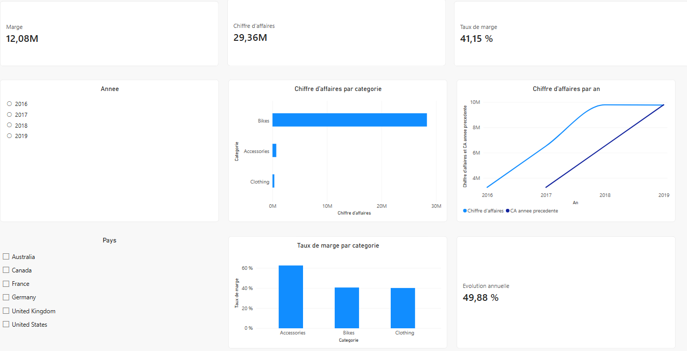
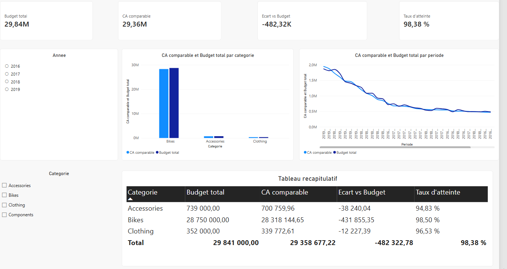
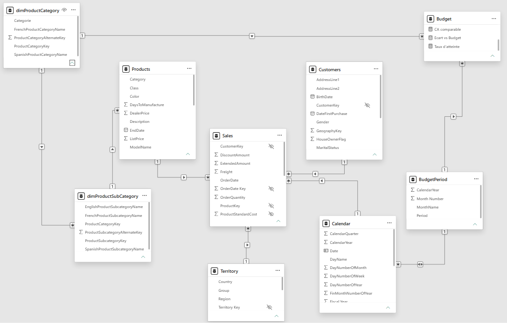

# Analyse des ventes et du budget Adventure Works avec Power BI

Tableau de bord Power BI en deux pages construit sur le jeu de données **Adventure Works** : une page d'analyse des ventes et une page de comparaison entre le budget et le réel.

> Auteur : DONGMO FEUDJIO Divin Virlence · Outils : Power BI Desktop, Power Query, DAX

## Objectifs

- Construire un modèle de données en étoile à partir de plusieurs tables liées
- Suivre le chiffre d'affaires, la marge et leur évolution dans le temps
- Comparer le réel au budget par catégorie de produits et par mois
- Formuler des recommandations à partir des résultats

## Résultats clés

| Indicateur | Valeur |
|---|---|
| Chiffre d'affaires total | 29,36 M |
| Marge | 12,08 M (taux de marge de 41,15 %) |
| Part de la catégorie Bikes dans le chiffre d'affaires | environ 96 % |
| Budget total | 29,84 M |
| Écart réel − budget | −482 K (taux d'atteinte de 98,38 %) |

Les trois catégories (Accessories, Bikes, Clothing) sont légèrement sous leur budget. La catégorie Bikes explique environ 90 % de l'écart total.

Le détail de la démarche, des mesures DAX et des recommandations se trouve dans le [rapport complet](docs/rapport_projet.md).

## Aperçu







## Contenu du dépôt

```
.
├── README.md
├── docs/
│   └── rapport_projet.md     # rapport détaillé et recommandations
├── images/                   # captures d'écran du rapport et du modèle
└── powerbi/
    └── Adventure_work_powerbi_analysis.pbix
```

## Données

Les données ne sont pas incluses dans ce dépôt. Elles proviennent du jeu d'exemple Adventure Works, téléchargeable sur https://exceleratorbi.com.au/adventure-works-sample-database/ (version Excel).

## Ouvrir le rapport

1. Installer **Power BI Desktop** (Windows uniquement).
2. Ouvrir le fichier `powerbi/Adventure_work_powerbi_analysis.pbix`.
3. Si Power BI ne trouve pas les données, aller dans **Accueil → Transformer les données → Paramètres de la source de données**, puis indiquer le chemin du classeur Excel téléchargé.

## Compétences mises en œuvre

- Import et nettoyage de données avec Power Query
- Modélisation en étoile et gestion des relations
- Mesures DAX (somme, ratios, filtres, comparaison avec l'année précédente)
- Conception de tableaux de bord interactifs (segments, mises en forme)
- Analyse budget contre réel et rédaction de recommandations
